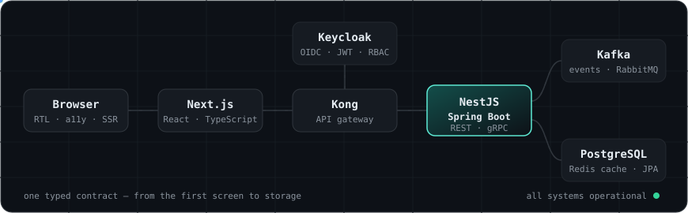

 

  

## How I build

  

I own features end to end: the interface people touch, the API behind it, the identity layer that guards it, and the event pipeline that keeps it in sync. Typed contracts on both sides, role-based access by default, and services that stay fast as the product grows.

## Stack

<table>
  <tr>
    <td width="130"><b>Interface</b></td>
    <td></td>
  </tr>
  <tr>
    <td><b>Services</b></td>
    <td></td>
  </tr>
  <tr>
    <td><b>Data</b></td>
    <td></td>
  </tr>
  <tr>
    <td><b>Platform</b></td>
    <td></td>
  </tr>
  <tr>
    <td><b>Also</b></td>
    <td></td>
  </tr>
</table>

  
  
  
  
  
  
  
  

## Path

| When | Where | What I built |
| --- | --- | --- |
| 2024 — now | **Isiran** | User management (React · Spring Boot · Keycloak), news platform (React · NestJS), video management system (NestJS · Kafka) |
| 2026 | **Erico** | Infrastructure services — Spring Boot · Angular · Kong · SpiceDB |
| 2025 — 2026 | **Arnitex** | Digital exchange — Java · Spring Boot · React · Next.js |
| 2020 — 2023 | **Segal Rayane** | Taught frontend and Java to the next generation of developers |

## Signal

<picture>
  <source media="(prefers-color-scheme: dark)" srcset="https://raw.githubusercontent.com/abnos5525/abnos5525/output/snake-dark.svg" />
  
</picture>

